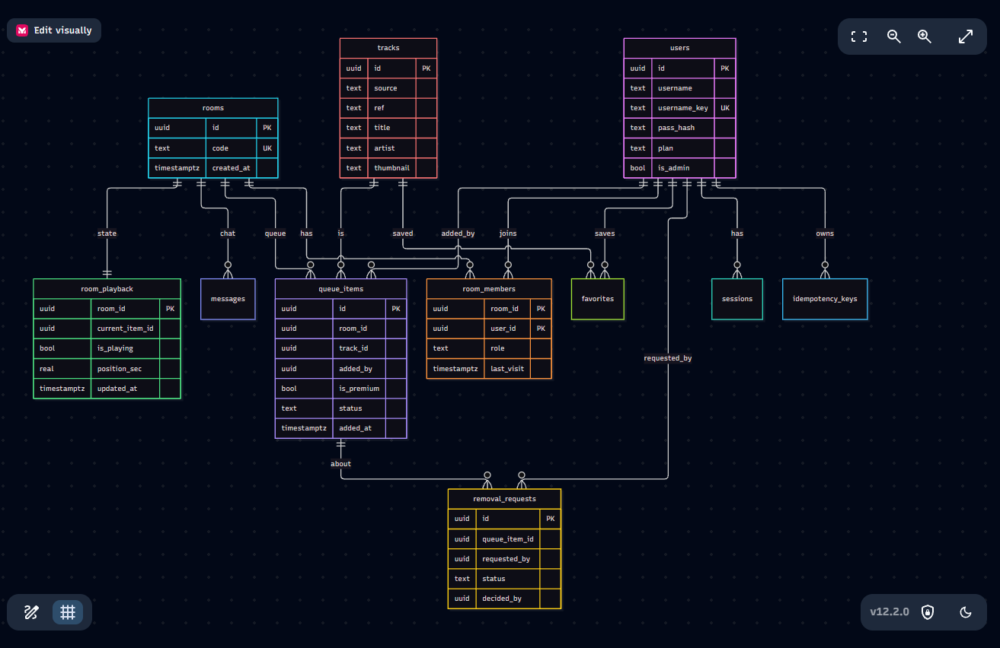

# Spec — Завдання 2: VV Audio, робочий застосунок (прототип → БД)

хочу зробити апку яка буде для того щоб прослуховувати музику з друзями бо в спотiфае ця штука тiльки з премкою а я хочу зробити free вот i тому 
сам рiшення не приймай тут дев я а ти мiй iнструмент для написання бойлерплейту задавай наводящие питання 

## Намір

Зробити сервiс для прослуховування музики паралельно з друзями. Щоб кожен мiг побути дiджеем

## Ролі та доступи

Premium-user : имеет ацес к тому щоб додавати пiснi вище в стек нiж регулар юзер на фри сабскрипшине 2:1 приотритет стеку очередi.
Regular-user : може додавати будь-якi треки але стек його не в прiоритетi макс селф креейтед рум макс число 5 тобто макс 5 кiмнат

## Сценарії та очікувана поведінка

одна строка = сценарій + хто + очікуваний результат.

порядок черги 2:1 як рахується, що буває, коли один тип треків закінчився, коли фіксується премиум;
запит на видалення юстани, хто вирішує, що з повторним запитом
трек закінчився від кількох клієнтів
збій джерела метаданих скільки ретраїв, пауза, що стається потім
що відбувається при повторі запиту

## Схема БД
  
## Ключові запити

стейт кiмнати при входi - n+1 якщо чергу читати отдкльно, а потiм по одному треку на кожну строку ми можем це виправити через join queue_items tracks
my rooms - кiмнати якi створив юзер тут теж n+1 якщо 'число трреков' в циклi по кiмнатам солюшн GROUP BY ro LEFT JOIN LATERAL
верифай ролей - яка роль юзера в кареент руме пошук по (room_id, user_id)
запрос на видалення з черги - новий або вже iснуючий визива н а кожну дiю це пошук по PK
чат рум хистори - в руми ще реалтайм чат де можно домовитись що далi слухати

## Помилки

400 - validation_error  - тело запита не пройшли схему наприклад месседж де нема нiчого ghost message, логiн > 64 chars
401 - unauthenticated - нема сесii
403 - forbidden - бан в румi
404 - нема комнати тако
409 - username_taken  - логiн вже хтось використову
422 - друге тiло запроса
429 - rate_limited вiд спаму або багато запросiв
503 - db_unavailable - бд впала або не доступна ендпоинт хелс теж верта 503

## Критерії прийняття

1. Дано: регулар-юзер есть 5 макс комант лимит - 5 Коли: вiн ствроюе 6 Тодi: throw 402 error
2. Дано: регулар-юзер надіслав POST з Idempotency-Key: і отримав 201 з стека Коли: через секунду той самий запит з тим самим ключем Тоді: відповідь 201 з тією самою бронню, у БД одна бронь, а не дві
3. Дано: вільний один мiсце в стеку Коли: двоє регулар-юзера одночасно бронюють його. Тоді: один отримує 201, другий — 409 LIMIT_EXCEED у БД рівно одна бронь стеку
4.  Дано: користувач є учасником 20 кімнат, у кожній по 30 треків.Коли: він відкриває мои руми. Тоді: сервер виконує не більше 3 SQL-запитів

